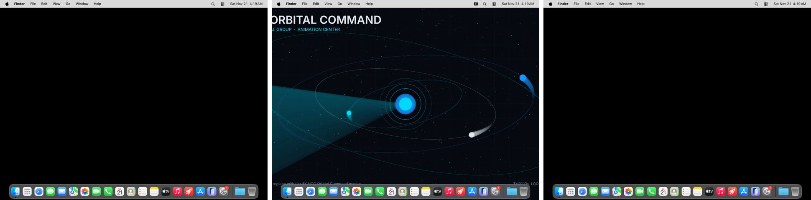
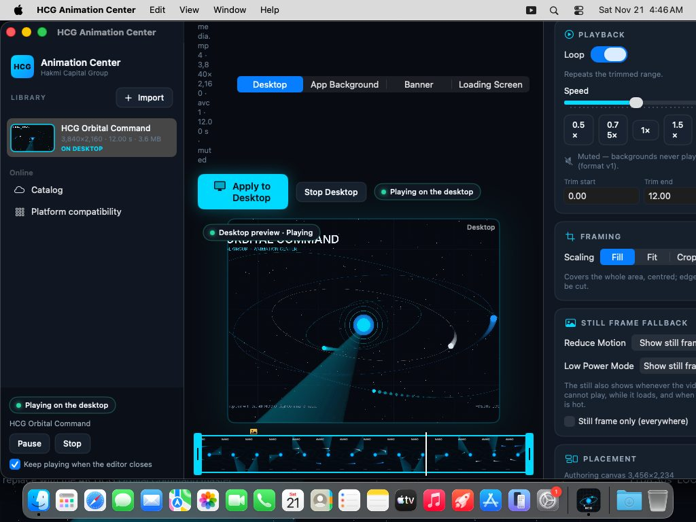
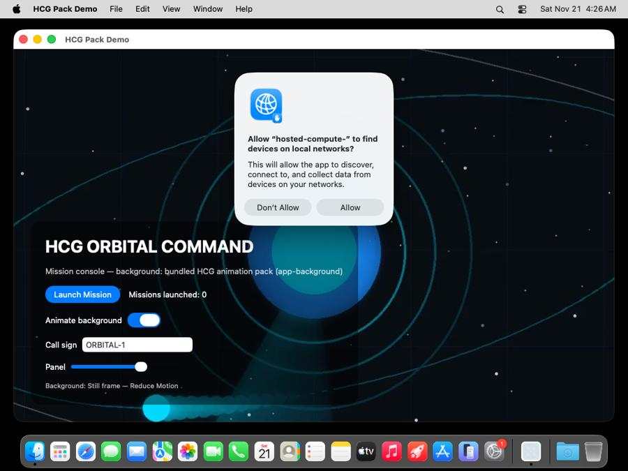

# Verification report — milestone 1

## Where things ran

| Environment | What ran | Physical Mac? |
|---|---|---|
| Linux container (build session), Swift 6.0.3, Python 3.13 | `HCGAnimationKit` tests (25), `hcgpack`, sample pack build, Python/JSON-Schema validator | no |
| GitHub-hosted `ubuntu-latest` | same as above + vendored-file checksums + compatibility-doc check | no |
| GitHub-hosted `macos-latest`: **macOS 26.7.2 (25G332), "Apple M1 (Virtual)", model VirtualMac2,1, one 1024×768 display, Xcode 26.6, Swift 6.3.3, macOS 26.5 SDK** | kit tests on macOS; universal app build; app self-test (real GUI session); shell-side screenshots; normal launch; Maker build of the demo and its checks | **no — virtual machine** |
| **MacBook Pro M4 Max, macOS 27** | **nothing yet** — [MAC-HARDWARE-CHECKLIST.md](MAC-HARDWARE-CHECKLIST.md) | — |

No Mac was attached to the build session, so **nothing ran on physical macOS hardware**, and nothing ran on macOS 27.
Real sleep/wake, real display hot-plug, real Low Power Mode and the energy cost of 4K playback are therefore
unverified until the hardware checklist is done.

Reference runs (all three jobs green): run 5, commit `079f1b5`
<https://github.com/F1r3srp3nt/animation-centre/actions/runs/44864892593>, and run 7, commit `246b238`
<https://github.com/F1r3srp3nt/animation-centre/actions/runs/44866380880> (self-test again 34/34:
[evidence/ci-self-test-run7.json](evidence/ci-self-test-run7.json)). Every push re-runs the same jobs.

## Mac app (job `macos`)

Build: `scripts/build-app.sh --universal` → `HCG Animation Center.app`, `x86_64 arm64`, `minos 14.0`, `sdk 26.5`,
`codesign --verify --strict --deep` valid (ad hoc). Download: artifact `hcg-animation-center-mac`
(`HCG-Animation-Center-mac.zip` + `.sha256`).

Self-test (`HCGAnimationCenter --self-test`): **34 / 34 passed**, 0 skipped. Full report:
[evidence/ci-self-test-run5.json](evidence/ci-self-test-run5.json). "sim" = drives the real code through the same
notifications/overrides the app listens to, because a VM can't sleep, hot-plug a display or toggle Low Power.

| Area | Result |
|---|---|
| Library | sample seeded; checksums verified; 4K clip probed 3840×2160, 12.00 s, avc1 |
| Import | MP4 ✓ · MOV ✓ · GIF → H.264 (320×180, 1.20 s) ✓ · damaged file refused ✓ · all imports muted, 4 placements, poster written |
| Placements render (same renderer as any Mac app) | Desktop fill 1.0× ✓ · App Background crop ✓ · Banner crop 0.75× ✓ · Loading Screen fit 1.5× ✓ — each "Playing", time advancing, layout equal to the C core's rectangle |
| Playback modes | play-once holds the last frame ✓ · unplayable → still (sim) ✓ |
| Apply to Desktop | one window per display, frame = display, desktop window level (−2147483623), ignores mouse, all Spaces ✓; window server lists it on screen ✓; video time advancing ✓ |
| Visible on the desktop | screenshots: 21.0 % of pixels differ from the normal desktop; 18.9 % change between frames 1 s apart ✓ |
| Menu bar commands | pause stops time advancing, resume continues ✓ |
| Display changes (sim) | synthetic second display added (window created and playing), removed, main resized, back to real displays ✓ |
| Sleep/wake (sim) | pauses on sleep, decoders released after 8 s (still shown), resumes and advances on wake ✓; displays asleep and screen lock pause/resume ✓ |
| Still-frame fallback (sim inputs) | Reduce Motion → still ✓ · Low Power → still ✓ · Low Power policy "normal desktop" → windows hidden ✓ · thermal → still ✓ · back to playing ✓ |
| Restore | Stop closes every desktop window ✓; system wallpaper setting unchanged ✓; screenshot after Stop **0.00 %** different from before Apply ✓ |
| Repeated apply/stop ×20 | played and stopped every time; 0 windows left; 0/20 window objects alive; memory 142 → 59 MB ✓; wallpaper still unchanged ✓ |
| Editor close | keeps playing only when enabled (menu bar), else stops and quits ✓ |
| Catalog | bundled catalog loads with poster and size ✓; download verified and cached ✓; poster ✓; failed refresh keeps the previous catalog ✓; plain HTTP refused ✓ |

From outside the app (CI shell, `screencapture`): normal desktop → app launched with `--apply-sample` → clip playing
behind menu bar and Dock → app quit → normal desktop. Thresholds checked by `scripts/screen_diff.py`.

Reduce Motion, for real: the Maker job's runner had **Reduce Motion on** at the system level; the demo showed the still
with reason "Reduce Motion" (below). The macOS job's runner reported it off.

The editor on the runner's 1024×768 screen (sample in the library, Desktop preview playing, trim timeline, applied to
the desktop behind it). This screenshot exposed two fixes made afterwards: the sample is now seeded once per library
folder, and the header wraps on narrow windows.

## Maker-built demo (job `maker-demo`)

HCG Executable Maker `2842998` (`main`, unmodified, v0.3.1) built `Samples/MakerDemo` **through its New Build wizard**
(headless driver over the real view-models): folder import → package `Samples/MakerDemo/Package.swift` → trusted
evaluation → product `HCGPackDemo` → contract shown and confirmed → `.app` + ZIP → **Build Succeeded: 2 artifact(s)
generated and verified · 0 warning(s)**, including Maker's own **"Contract resources: Passed"** for the four pack files.
Excerpt: [evidence/ci-maker-ui-driver-report-excerpt.txt](evidence/ci-maker-ui-driver-report-excerpt.txt). Contract
SHA-256 recorded by Maker: `ed1156f2…74cb`.

| Check | Result |
|---|---|
| Maker's `verify-macos-app.sh`: Info.plist, `codesign --verify --strict --deep`, arm64 slice, launch, screenshot | ✓ |
| `Contents/Resources/OrbitalCommand.hcgpack` byte-identical to `Samples/OrbitalCommand.hcgpack` (`diff -r`); Info.plist has `HCGAnimationPack` / `HCGAnimationPlacement` | ✓ |
| Run as a user would (runner's Reduce Motion **on**): pack loaded and verified, **still frame — Reduce Motion**, button and switch clicks work | ✓ [log](evidence/ci-maker-demo-run-reduce-motion.txt) |
| Playback (Reduce Motion ignored for the run): **Playing**, time 0.117 → 1.127 s, video on screen, still loaded, clicks work, background never hit | ✓ [log](evidence/ci-maker-demo-run.txt) |
| Playback unavailable (simulated): still shown, controls work | ✓ [log](evidence/ci-maker-demo-run-still.txt) |
| **Offline**: `sandbox-exec` with all networking denied → Playing, time advancing | ✓ [log](evidence/ci-maker-demo-run-offline.txt) |
| Maker's ZIP holds the same app and pack (`ditto -x -k`, `diff -r`) | ✓ ZIP SHA-256 `a5a0f8a0…8906` |

(The "hosted-compute" local-network prompt in that screenshot comes from GitHub's runner agent, not the demo.)

Note: the App Background placement is authored for a portrait phone canvas, so in a landscape Mac window its crop
shows a tall central strip scaled up — that is the placement's framing working as specified; a Mac app would normally
use a landscape placement.

## Format (all environments)

- 25 XCTests on Linux and on macOS: preset v1 parity with the iOS project's Aurora example and reader rules (refusals,
  repairs, warnings, bool/number strictness), C-core layout, pack read/write/verify/tamper/forward-compat/export to
  `.hcgbackground`, render policy, catalog parsing, URL rules, verified download + offline cache, tamper rejection,
  failed refresh keeps the last catalog (also across restarts), SHA-256 vectors (portable vs CryptoKit).
- `hcgpack validate` and the independent Python validator agree on the sample pack and both catalogs.
- Vendored C core and preset schema byte-identical to the iOS project (checked in CI).
- The sample pack rebuilds byte-identically (`pack.json` SHA-256 `a8b25c69…27aa`).

## Not verified / known limits

- No physical Mac, no macOS 27 (see top). Hosted runners show one 1024×768 display.
- Display changes, sleep/wake, screen lock, Low Power and heat were exercised through the app's own notification and
  override paths, not by the OS events themselves.
- Clicks in the demo go through `NSWindow.sendEvent` (AppKit's real hit-testing), not through the window server.
- The clip is a generated stand-in; your 4K master has not been imported anywhere yet.
- The editor UI was launched and screenshotted, not driven step by step (trim drag, crop sliders, exports are covered by
  the hardware checklist H2/H18).
- Lock Screen video: separate milestone, not started.
